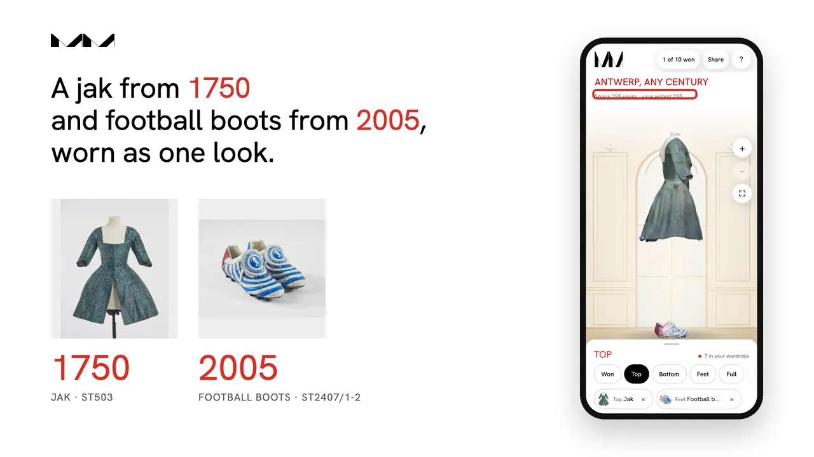
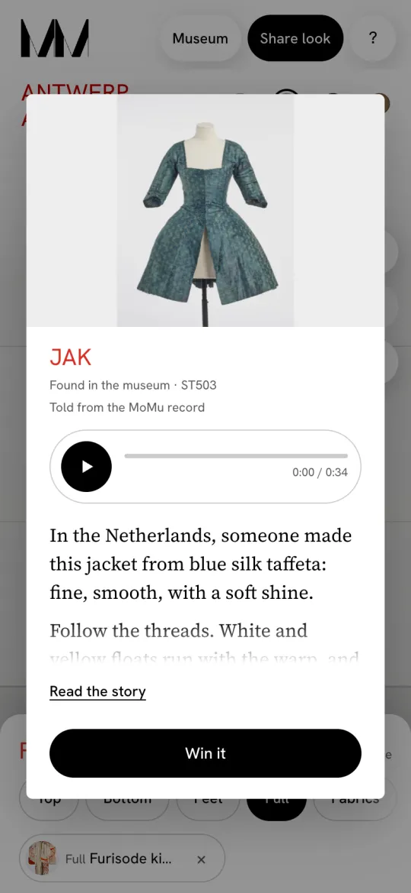
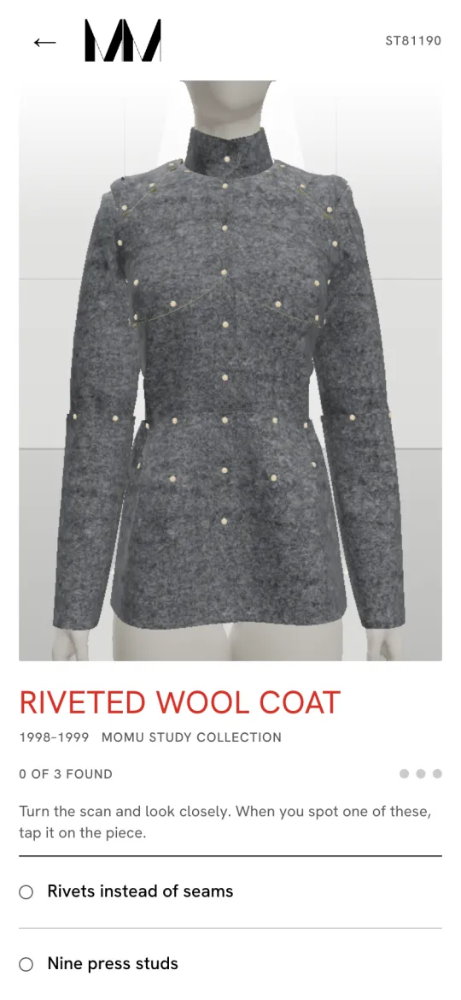
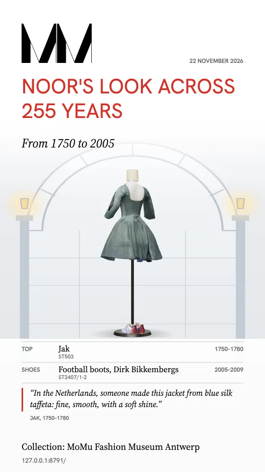
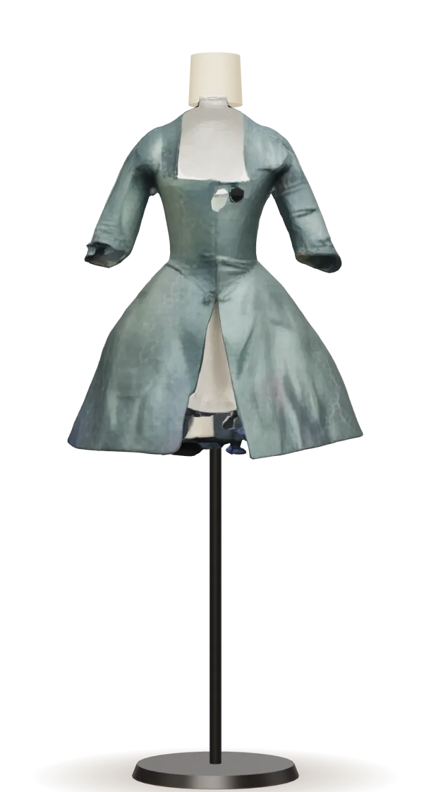
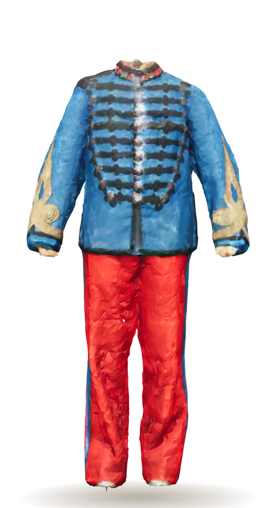
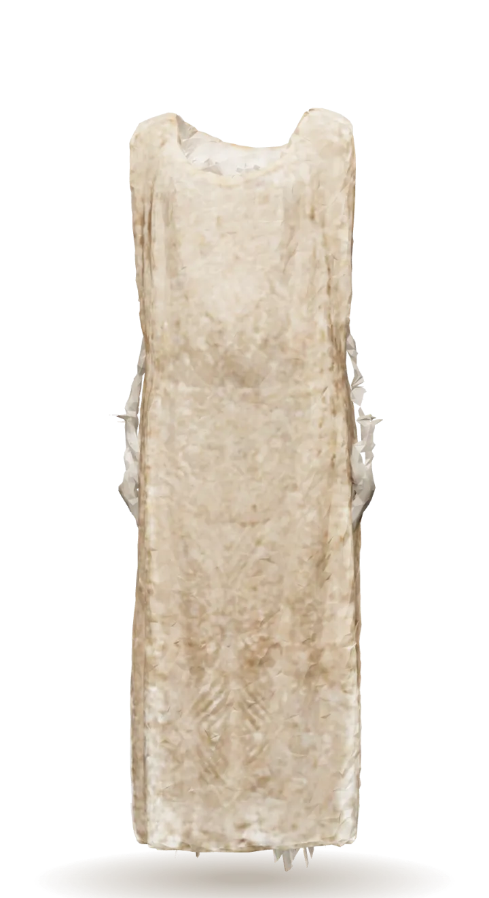
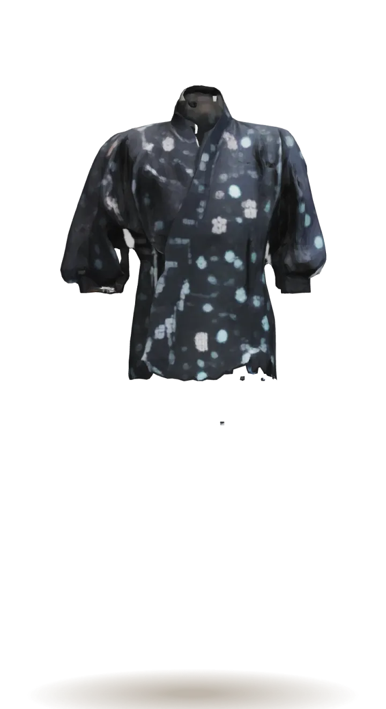
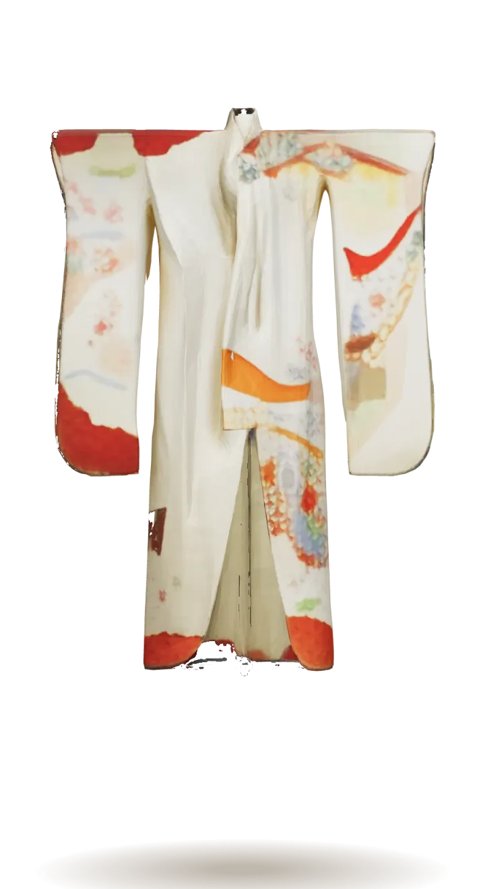
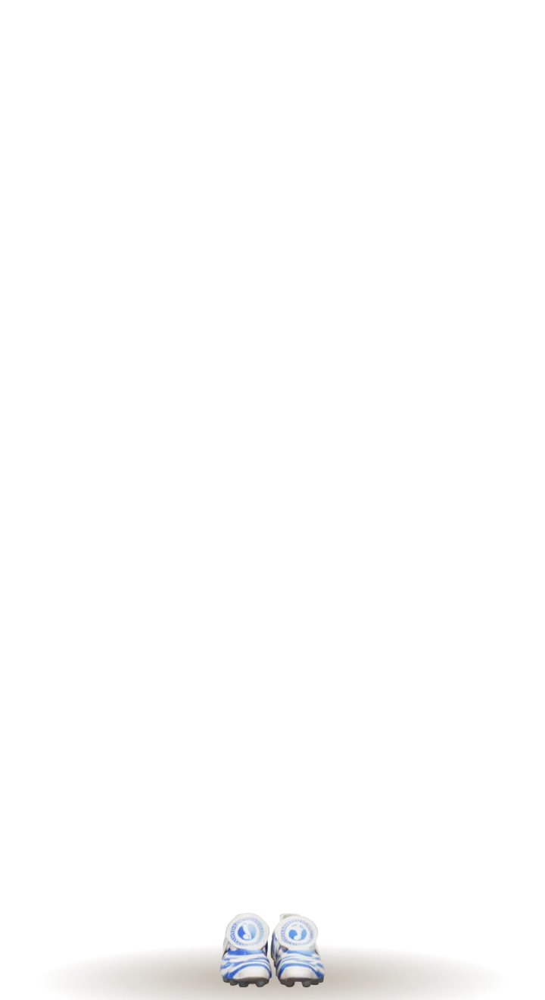

<p align="center">
  <picture>
    <source media="(prefers-color-scheme: dark)" srcset="docs/readme/momu-logo-white.svg">
    
  </picture>
</p>

<h1 align="center">Designer Quest</h1>

<p align="center">
  <b>Tap a real MoMu piece, hear its story, win it, and wear it in a look that spans 255 years.</b><br>
  Team C Blanco · MoMu Hackathon 2026 · MoMu Fashion Museum Antwerp
</p>

<p align="center">
  <a href="https://designer-quest-momu.vercel.app"><b>Open the live app</b></a> ·
  <a href="https://designer-quest-momu.vercel.app/?card=ST503">Scan the jak (demo card)</a> ·
  <a href="mockups/assets/landing/momu-teaser.mp4">Watch the 44 s teaser</a> ·
  <a href="presentation/TEAM%20C%20BLANCO_MoMu%20Hackathon%20presentation.pptx">Pitch deck</a>
</p>

<p align="center">
  <a href="mockups/assets/landing/momu-teaser.mp4">
    
  </a>
  <br><sub>▶ Click the poster to play the teaser</sub>
</p>

---

## The challenge

> How can we make the MoMu Study Collection more accessible and interesting to a younger audience (15 to 25)?

MoMu's Study Collection is archive and storage, not gallery: inventory numbers, boxes and Dutch-only labels.
Young visitors rarely see it, and "fashion history" sounds like an exam.

## Our answer

**Designer Quest** is a phone web app for the museum floor. No install, no account.

1. **Scan.** A card or NFC tag beside a real piece opens it on your phone.
2. **Listen.** Its story, narrated and told from the museum's own record.
3. **Win it.** Guess the year it was made, or find the three details the curators recorded on a 3D scan.
4. **Wear it.** Every piece you win joins your wardrobe and goes on stage: a 1750 jak with 2005 football boots.
5. **Remix and share.** Put one century's fabric on another and share a 9:16 card that credits MoMu.

<table>
  <tr>
    <td align="center" width="33%"><br><b>Story</b><br><sub>Narrated, from the MoMu record</sub></td>
    <td align="center" width="33%"><br><b>Up close</b><br><sub>Find the 3 recorded details on a 3D scan</sub></td>
    <td align="center" width="33%"><br><b>Share</b><br><sub>A look no century could have made</sub></td>
  </tr>
</table>

<p align="center">
  
  
  
  
  
  
  <br><sub>Real Study Collection pieces, 1750 to 2009, rendered from the app's own stage</sub>
</p>

## What makes it work

- **The museum's own words.** Every date and fact comes from MoMu's collection records; a missing field says
  "not recorded". *Ask the archive* answers questions from one record and drops anything it can't quote.
- **Play before reading.** You win a piece by noticing something about it. Nobody can lose: the third miss wins anyway.
- **Real garments in 3D.** 19 pieces: photo-to-3D scans (TRELLIS), MoMu's CLO models and Gaussian splats of study pieces.
- **Three languages.** Dutch, English and French, with narration for every piece.
- **Zero friction.** A static web app, progress kept on the phone, nothing stored on a server.

## Under the hood

| Part | What |
|---|---|
| Collection DB | MoMu's public collection harvested from the Omeka S APIs (studycenter.momu.be, heron.libis.be/momu) into Postgres: **4,622 objects, 9,323 media** |
| App | Static HTML/JS on Vercel, three.js stage, one shared garment shader with triplanar fabric remix |
| 3D pipeline | Photo → garment cutout (SegFormer) → TRELLIS image-to-3D → GLB → auto-fit by slot; splats via PlayCanvas `splat-transform` |
| Ask the archive | Serverless `/api/ask`, answers grounded in a single public record |
| Teaser | Made in code with Remotion from real captures of the app |

```
momu-collection-db/
├── harvester/      # fetch (API → cache) and load (cache → Postgres)
├── schema.sql      # objects, values, concepts, agents, media, showcases
├── seed/           # loaded data dumps
├── mockups/        # the app: index.html (landing), atelier.html (Stage), up-close.html, assets, tools
├── presentation/   # pitch deck, storyline, Remotion teaser (reel/)
└── docs/           # project notes, wearable-scan pipeline
```

More detail: [ARCHITECTURE.md](ARCHITECTURE.md) (components, data flow, how-tos), [DESIGN.md](DESIGN.md),
[PRODUCT.md](PRODUCT.md), [docs/PROJECT_NOTES.md](docs/PROJECT_NOTES.md) (problem, ideation, visitor flow) and
[presentation/STORYLINE.md](presentation/STORYLINE.md) (persona and demo script).

## Run it locally

```
cd mockups && python3 -m http.server 8765 --bind 127.0.0.1
```

Open <http://127.0.0.1:8765/> for the landing page or `/atelier.html?card=ST503` to simulate scanning a card.
The app alone needs nothing else; the 3D pipeline and DB need the steps below.

<details>
<summary>3D pipeline, database, narration and Ask</summary>

```
python3 -m venv .venv && .venv/bin/python -I -m pip install -r requirements.txt
cp .env.example .env && chmod 600 .env && zsh tools/set_hf_token.sh   # your own HF token
createdb momu && pg_restore -d momu --no-owner seed/momu_full.dump    # collection DB

.venv/bin/python -I mockups/tools/batch_glb.py       # GLB for every unlocked piece that lacks one
.venv/bin/python -I mockups/tools/make_swatches.py   # Remix fabric swatches
```

- Pieces: `mockups/pieces.json` (schema `pieces.schema.json`) is read by both the app and the pipeline.
- Narration: `mockups/tools/narration.py` builds `narration.json`; facts are checked with `narration_facts.py`.
- Languages: UI strings in `mockups/i18n/`, built with `mockups/tools/i18n_build.py`.
- Ask the archive: `cd mockups && npm install && npm run dev:ask`; eval with `npm run eval:ask`.
- Wearable scans: [docs/WEARABLE-PIPELINE.md](docs/WEARABLE-PIPELINE.md). Teaser: [presentation/reel/README.md](presentation/reel/README.md).

</details>

## Team

| | |
|---|---|
| **the team** | 3D models and splats |
| **Mubasil** | UI / UX and deploys |
| **Hassan** | AI, data and narration |
| **the curator** | Fashion history, stories and questions |

<sub>Collection data, photos, 3D captures and the MoMu logo belong to MoMu Fashion Museum Antwerp and were used for the hackathon.</sub>
