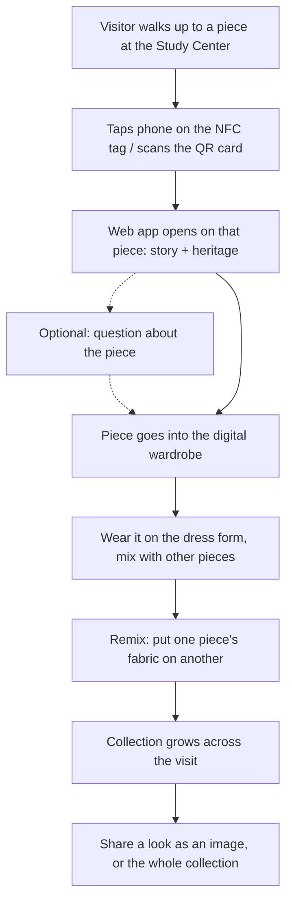

# Project notes

The shared reference for the whole team: what problem we picked, how we got to the idea, what the visitor does,
who owns what, and what is still open. Engineering detail lives in `ARCHITECTURE.md`; tickets and decisions
D1 to D8 live in `LEDGER.md`; the pitch and demo script live in `presentation/STORYLINE.md`.

Edit freely. When you change something the team agreed on, say so in the commit message.

## Problem statement

> How can we make the MoMu Study Collection more accessible and interesting to a younger audience (15 to 25)?

The Study Collection is mostly archive and storage, not gallery. Young people rarely see it, and "fashion
history" reads as something for specialists. We want them to touch it (with their phone), keep it and show it off.

## How we got here

Lotus Blossom ideation: each of the 4 team members brought 2 ideas around the problem statement, then we
clustered them into "what needs to be considered about the user" and refined one interaction.

### What needs to be considered about the user

| Theme | Notes from the session |
|---|---|
| Reach | Should we make it accessible to a broader audience, and if so how? |
| Hook | What's the initial hook? Where does the user first see this, and what entices them? |
| Perception | How do we deconstruct the perception around engaging with fashion history? |
| Gamification | Options: quiz, try-on, customisation, AR, social repost, collecting |
| Style | Follow the MoMu style guideline (MoMu design folder) |
| Outcomes | Engage young people in a relatable way: those who **don't** follow fashion, and those who **do** and want to flex their knowledge or style |
| Retention | Education and immersion; give people a reason to come back |
| Accessibility | Zoom, full screen, help button, first-time help pop-up with a skip button |
| Also to cover | Roadmap, pipeline, try-on picture, terms and conditions |

## The idea

**Tap a real MoMu piece, hear its story, collect it, wear it, share it.**

A phone web app (no install). Each Study Center piece has an NFC tag or QR card. Tapping it opens that piece in
the app: its story first, then a chance to win it into your digital wardrobe. Over the visit you build a
collection, dress a 3D museum dress form in pieces centuries apart, remix fabrics across them, and share the look.

### Visitor flow

| Step | What happens | Built? |
|---|---|---|
| 1. Discover | Visitor walks up to a piece at the Study Center | n/a |
| 2. Trigger | NFC tap or QR card opens `?card=<inventory id>` | Card URL and simulated tap: yes. Physical tags: need MoMu's OK |
| 3. Story | Narration and heritage text from the MoMu record | Fact card (ⓘ) with record text and translation: yes. Narration audio: no |
| 4. Question | One question per piece; a right answer wins its fabric | No (ticket C2) |
| 5. Collect | Piece lands in the wardrobe sheet, saved on the phone | Yes |
| 6. Wear | 3D dress form, pieces auto-fitted by slot | Yes |
| 7. Remix | Fabric of one piece on the body or sleeves of another | Yes |
| 8. Look closer | Study pieces (3D splats): find 3 recorded details to win the fabric | Yes |
| 9. Share | 9:16 share card: look name, span in years, MoMu credit | No (ticket B7) |

### Why it answers the considerations

| Consideration | Answered by |
|---|---|
| Hook | Tapping a real object, then seeing it on a form you control |
| Perception of fashion history | History arrives through play: a look that spans 250 years is the punchline, not a lecture |
| Non-fashion youth | Low barrier: tap, watch, wear; no account, no install |
| Fashion-engaged youth | Collect rare pieces, build looks, flex the span and the story |
| Coming back | Locked pieces show where their card is; the collection only grows in the room |
| Truthfulness | Every fact comes from a MoMu record; missing fields say "not recorded" (D3) |

## Decisions (team level)

The engineering decisions are D1 to D8 in `LEDGER.md`. Team decisions from the ideation:

| Date | Decision | Why |
|---|---|---|
| 2026-11-21 | Concept: NFC/QR piece stories, digital wardrobe, try-on, share | Outcome of the Lotus Blossom session |
| 2026-11-21 | Tags and cards live at the Study Center | That is where the Study Collection is |
| 2026-11-21 | Web app, not native | Tap and it opens; no install between the visitor and the piece |
| 2026-11-21 | Selfie is optional, never required | Lower barrier, less personal data |

### Open: selfie and sign-up vs the repo's rules

The ideation flow had a sign-up step with an optional selfie try-on. `LEDGER.md` says the avatar stays a dress
form (D1) and there are no accounts or personal data (D2). These conflict; the team decides before anyone builds
sign-up or selfie try-on. If the selfie stays: explicit opt-in, processing on the phone, nothing stored, and a
privacy notice that covers visitors under 18 (GDPR).

## Team

| Person | Focus | Owns now |
|---|---|---|
| the team | 3D models | Smaller GLBs for venue wifi (A5), kimono rescan, splat outfits (G2 to G4), new season models (D-4) |
| Mubasil | UI / UX, deploys | Phone memory (A6, in review), share card (B7), Piece page on the engine (A4), phone UI polish, backup video (E2) |
| Hassan | AI and data | Question engine (C2), translation of Dutch-only records (D-3), narration audio, season export (D-1) |
| the curator | Fashion and content | Question and fact text (C2), review of the fact-card translations (C1 is built), story scripts, fashion review of looks, MoMu contact, pitch |

Pairs: the curator writes questions, Hassan builds the engine; the curator writes story scripts, Hassan voices them;
Hassan translates, the curator checks the fashion terms.

## Open questions

- [ ] Product name.
- [ ] Selfie and sign-up vs D1 and D2 (above).
- [ ] MoMu: curator sign-off on the facts, permission to place NFC tags or QR cards, image rights per piece.
- [ ] MoMu Drive: pattern files, an empty form scan, the missing splat MOMU-5.
- [ ] Venue wifi: scans are 14 to 17 MB each; presenter phone on a hotspot, recorded fallback ready.

## Where things are

| What | Where |
|---|---|
| Pitch, demo script, persona | `presentation/STORYLINE.md` |
| Tickets, decisions, cut, risks | `LEDGER.md` |
| Where work stopped | `HANDOVER.md` |
| How the app is built | `ARCHITECTURE.md`, `README.md` |
| Live demo | Vercel project on Mubasil's account (see Deploy in `ARCHITECTURE.md`) |
| Task board | Team Notion page "MoMu Hackathon" |
