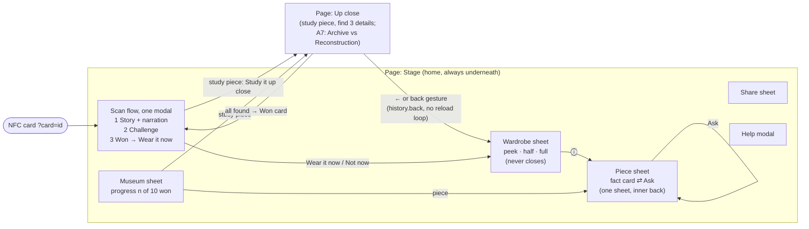

# UX audit and navigation map (H6)

Walked on `main` at `2780db5`, 2026-11-21, 390 × 844 viewport (Playwright Chromium, plus the in-app browser
with touch emulation). Screenshots: `docs/ux-audit/before/`. Skills applied: `/impeccable` (audit) and
`/emil-design-eng`. The story beats and their order stay as they are; this is only about how the visitor moves
between them.

**Status: proposal. Nothing is implemented until Hassan approves.**

## What was walked
| Flow | Screens (`docs/ux-audit/before/`) |
|---|---|
| First visit, then a return visit | `01` help, `02`/`03` Stage |
| Wardrobe, fact card (won and locked piece), Ask, Share, Museum, NFC "simulate" popup | `04` to `10` |
| Card scan of a wearable `?card=ST503`: story, Guess the year, won, wardrobe | `11` to `14` |
| Scanning it again, an unknown card | `15`, `16` |
| Card scan of a study piece `?card=ST81190`: story, Up close, back, all 3 found, fabric won | `17` to `23` |
| Language toggle (D-3) | read from `hassan/D-3-i18n`; not on `main` yet |

Detector baseline (`impeccable detect --viewport 390x844`): `second-skin.html` 0 findings, `up-close.html?id=ST81190`
0 findings and 1 advisory (one-word last line). Console: no errors except one 404 on the very first cold load, not reproduced on reload (likely the browser's
favicon request). The problems below are flow problems
the detector cannot see.

## Findings, ranked
P0 blocks the story; P1 makes it feel broken; P2 friction; P3 polish. "Owner" is who has to agree before the change.

| # | Sev | Finding | Evidence | Owner |
|---|---|---|---|---|
| 1 | P0 | **The phone's back gesture leaves the app from anywhere.** Every layer (help, fact card, Ask, Share, Museum, story, Win, NFC popup) is a `<dialog>` with no history entry, so Android back or iOS edge-swipe exits the site instead of closing the top layer. Leaving from the first-visit help also means it shows again next time (its `close` never ran). | back with Help or Ask open went to `about:blank`; `history.length` stays 2 through every layer | Hassan (all files) |
| 2 | P1 | **Up close is a separate page and every move to or from it is a full reload.** Stage → Up close uses `location.replace` (story → Up close) or `location.href` (Museum); Up close's ← is a plain link, so it *adds* an entry: the next back gesture returns **into** Up close (a loop). After the fabric is won (`?fabric=`), back also lands on Up close again. The Stage reboots its GLBs each time; the open wardrobe tab and sheet position are lost. | `18`, `19`; back after ← returned to `up-close.html?id=ST81190` | Hassan (A7 also edits `up-close.html`) |
| 3 | P1 | **Dismiss means "continue".** Escape or a backdrop tap on the story sheet starts Guess the year (wearable) or jumps to Up close (study piece). The Win dialog refuses Escape entirely. A visitor who scanned by accident or wants to come back later has no way out except finishing. | `12`: Escape on the story opened Win | Basil (Win flow, `win.js`) + Hassan (`story.js`) |
| 4 | P1 | **The wearable story has no narration.** The play button is hidden before Guess the year because the audio opens with the years. For ST503, the opener in the demo script, beat 3 ("story with narration") does not happen. | `11`: no player on the Jak story | Hassan (H3) + the curator (text); a flow fix, not new content |
| 5 | P1 | **After winning, the piece is not worn.** "Add to my wardrobe" drops the visitor on the half-open sheet with a toast "Tap it to wear it": one more tap, and the wear beat happens off-camera. | `13`, `14` | Basil (Win flow), D2 heads-up |
| 6 | P1 | **Five overlay styles and lost context.** Centre modals (fact card, story, Win, Museum, Help, NFC), a tall modal (Share), a bottom sheet (Ask) stacked over the wardrobe sheet. Fact card → Ask *closes* the fact card, so closing Ask drops you on the Stage, not back on the piece. Museum → ⓘ closes the Museum; closing the fact card does not return to it. | `05` → `06` → `07` | Hassan (fact, Ask, Share), Basil (Museum, NFC, Help) |
| 7 | P2 | **The last beat is the loudest button.** "Share look" is the only solid button in the top bar from the first second, while progress ("0 of 10 won") is hidden inside the Museum modal. Nothing on the Stage says what to do next or how far along the visit is. | `03` | Basil (top bar) |
| 8 | P2 | **The language switch reloads the page** (D-3 branch): open sheet, tab, scroll and an unanswered Ask are lost; on Up close the splat downloads again. | `i18n.js` line 104 on `hassan/D-3-i18n` | Hassan (D-3) |
| 9 | P2 | **False and thin affordances.** Ask's handle is a decorative `` that cannot be dragged. The wardrobe handle button is 22 px tall (its drag area is larger, but the button alone fails 44 px). The "wearing" chips row is cut off at 390 px with no cue that it scrolls. A locked Jak sits in the Top grid ("Win it in the museum") though the Museum says room pieces live outside the wardrobe. | `04`, `06` | Basil (sheet B3), Hassan (Ask) |
| 10 | P2 | **Two different headers.** Stage: wordmark + Museum / Share / ?. Up close: ← + wordmark + id, different type and spacing. Moving between them feels like changing apps. | `03` vs `18` | Hassan |
| 11 | P3 | **Screen-reader structure.** No visible `h1` or `main` landmark at phone width; page title "Second Skin mockups"; every dialog focuses a bare `div` (`autofocus` wrapper) so the dialog's name is read but not its first action. Focus does return correctly after Ask closes. | DOM check | Hassan |
| 12 | P3 | **Motion is uneven.** Dialogs use `@starting-style` scale-in (good), but there is no transition between pages and the scan flow swaps dialog content with no change of state shown (story → guess → won reuse one box with a hard cut). | `11` → `12` → `13` | Hassan |

What already works and stays: the wardrobe sheet's peek/half/full with flick snapping (B3/B4), 44 px chips and
tiles, `touch-action: none` on the turntable and sheet grab (no gesture fight in testing), focus return after Ask,
reduced-motion rules on the sheets and help, card scan reaching the story in under 0.2 s locally.

## Proposed navigation map

The beat order is unchanged: scan → story with narration → challenge (guess, or Up close for study pieces) → won →
in the wardrobe → worn on the Stage → remix → Up close → Ask → share. Only the containers and the way back change.

### Rules
| Kind | What | Behaviour |
|---|---|---|
| **Page** (full screen, own header) | Stage, Up close | One shared header: ← (only on Up close), title, progress chip, help. Moving between them uses a cross-document View Transition (fade + 8 px slide, 220 ms, `cubic-bezier(0.23,1,0.32,1)`; plain fade under reduced motion), so it reads as one app even though it is two documents. Up close's ← calls `history.back()` when the Stage is the previous entry, else `location.replace` to the Stage: never a new entry, never a loop. |
| **Sheet** (bottom, draggable, shows the Stage behind) | Wardrobe (persistent), Piece (fact card ⇄ Ask in one sheet with an inner ‹ back), Share, Museum | Anything that acts on the look or a piece. At most one sheet above the wardrobe. Real handle that drags; flick down or tap the backdrop to close. Fact → Ask is a push inside the same sheet, so back returns to the fact card. Museum → piece replaces the Museum with the Piece sheet and its back returns to the Museum. |
| **Modal** (centred, blocks) | Scan flow, Help, NFC "hold your phone" | Only for moments that interrupt on purpose. The scan flow is one modal with a step line (Story · Challenge · Won) and a visible **Not now** on every step: the piece simply stays in the Museum. Backdrop tap does nothing (no accidental "continue"); Escape and back = Not now. |
| **Toast** | confirmations | Never the only way to learn the next step. |

**Back, everywhere:** each sheet or modal pushes one history entry when it opens (`history.pushState({layer})`);
the back gesture, Escape, the × and a flick all close the top layer only. On the bare Stage, back leaves the site
as it should. A card scan replaces its URL (as today), so reload never replays it.

**Where am I:** the Stage header shows a progress chip ("2 of 10 won", opens the Museum) instead of a plain
"Museum" button; Share moves to a quieter pill (it stays one tap away, but is no longer the first thing the eye
lands on). The wardrobe peek always shows what is worn.

**Fixes inside the beats (no reorder):**
- Story for a wearable plays its narration (the player starts after the years are spoken, or the audio is trimmed
  to skip them; Hassan to pick) so beat 3 happens for ST503.
- The Won card's main action becomes **Wear it now** (puts it on and lowers the sheet to peek so the form is seen);
  "Add to my wardrobe" stays as the quiet second choice.
- Language switch swaps strings in place where it can; where it must reload, it restores the open sheet and tab
  from `sessionStorage`.

### Motion (emil-design-eng)
| Thing | Motion | Why |
|---|---|---|
| Sheets open/close | `transform` only, 260 ms in, 200 ms out, `cubic-bezier(0.32,0.72,0,1)` (the wardrobe's curve) | One family of movement; exit faster than enter |
| Scan-flow steps | content crossfade + 6 px rise, 180 ms, `filter: blur(2px)` at the midpoint | Shows a state change in the same box without a hard cut |
| Page change Stage ⇄ Up close | View Transition, 220 ms ease-out; fade only under reduced motion | Hides the reload |
| Buttons | existing `.press` scale 0.97 | Already right |
| Reduced motion | opacity only, 150 ms; no slides, no scale | B8 |

## What touches other people's work
| Change | Files | Whose | Needs |
|---|---|---|---|
| History entries for every layer, one back behaviour | `second-skin.html`, `story.js`, `win.js`, `ask.js`, `share.js` | Hassan; `win.js` Basil | Basil heads-up |
| Scan flow as one modal with Not now; Wear it now on Won | `story.js`, `win.js`, `win.css` | Basil (Win flow, D2) | **Basil's OK** (D2 flow) |
| NFC popup and Help as the "modal" kind, Museum as a sheet, progress chip in the header | `second-skin.html` top bar, `#nfc`, `#museum`, `#help` | **Basil** (NFC popup redesign, onboarding) | **Basil's OK via Hassan**; wait for his popup redesign if it is in flight |
| Piece sheet (fact ⇄ Ask) | `second-skin.html` fact card, `ask.js`, `ask.css` | Hassan (C1 was Basil's) | Basil heads-up |
| Up close header, back, View Transition | `up-close.html`, `theme.css` | Hassan; **A7** edits `up-close.html` | Sequence with A7 |
| Language switch without losing place | `i18n.js` | Hassan (D-3, not merged) | Land D-3 first, then this on top |
| Wardrobe handle size, chips scroll cue | `second-skin.html` sheet CSS | Basil (B3/B4) | Basil heads-up |

**Sequencing.** `second-skin.html` may only be changed by one open branch at a time (AGENTS.md). Today
`hassan/D-3-i18n` changes it (117 lines) and is unmerged; `hassan/A7` changes `up-close.html`. Proposal: merge
D-3 first, then H6 in small PRs in this order: (1) back/history layer manager, (2) scan flow, (3) sheets,
(4) Up close header and transition. Each is verified at 390 px before the next.
